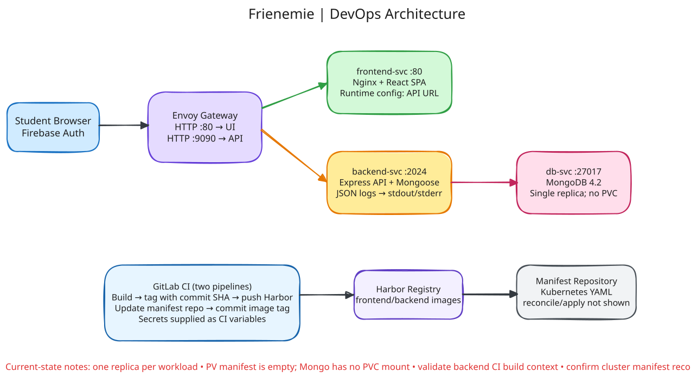
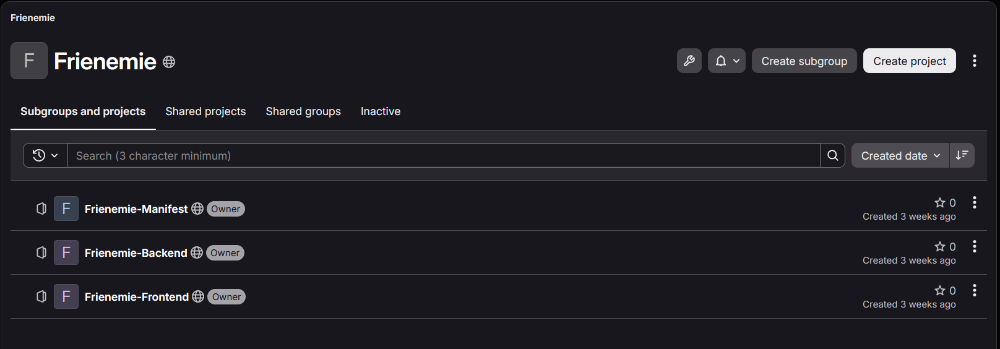
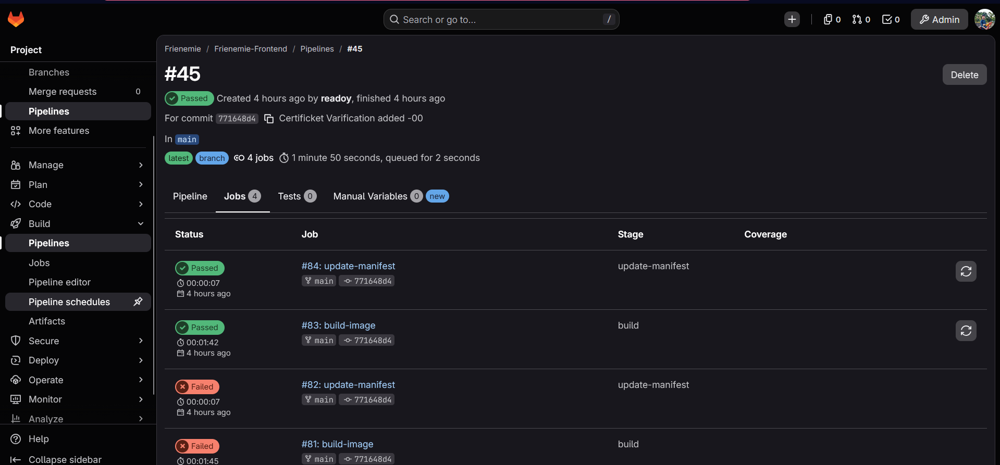
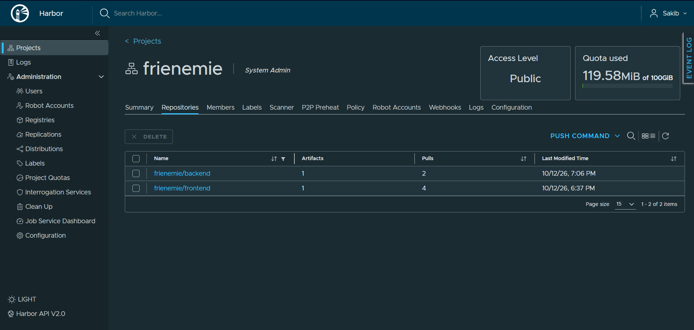
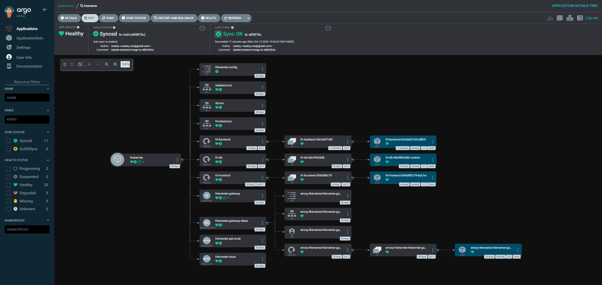
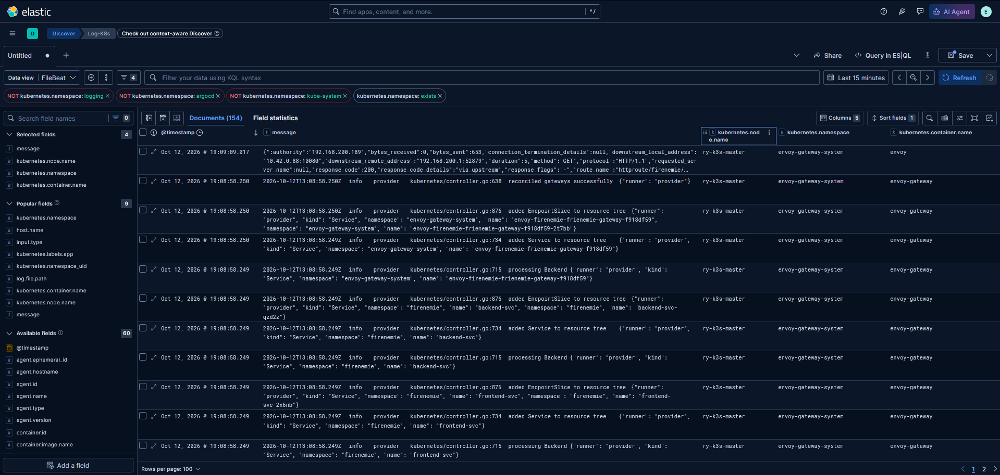

<div align="center">

# Frienemie — Assignment Tracker

### A containerized student productivity app with a GitLab CI/CD and Kubernetes delivery workflow


[Project Overview](#project-overview) · [DevOps Workflow](#devops-workflow) · [Screenshots](#screenshots) · [Run Locally](#run-locally)

</div>

## Project Overview

Frienemie helps students organize assignments, due dates, priorities, submission status, and grades. It combines a React frontend, an Express API, MongoDB persistence, and Firebase authentication with a container-based deployment workflow.

The repository is organized into three GitLab projects: **Frontend**, **Backend**, and **Manifest**. The application workloads are described with Kubernetes Deployments, Services, ConfigMaps, and Gateway API resources. GitLab pipelines build and publish versioned container images to Harbor, then update the corresponding image tag in the manifest repository. Argo CD monitors the manifest repository and syncs the desired state to Kubernetes. The included Argo CD screenshot shows the `frienemie` Application Healthy and Synced to `main`, with auto-sync enabled. Elastic/Kibana is used to explore Kubernetes and application platform logs.

> This repository is also a DevOps portfolio project: it demonstrates source organization, image delivery, declarative deployment, and centralized log exploration.

## Architecture



For the detailed pipeline stages and CI/CD variable guide, see the [CI/CD delivery flow diagram](docs/cicd-flow.excalidraw).

### Request flow

1. A student opens the React single-page application through the Envoy Gateway.
2. The frontend is served by Nginx and uses Firebase for client-side authentication.
3. The browser sends assignment API requests through the Gateway to the Express backend Service.
4. The backend uses Mongoose to read and write assignment records in MongoDB.
5. Application and Kubernetes logs can be explored in Elastic/Kibana.

### Delivery flow

```text
Frontend / Backend source commit
              │
              ▼
      GitLab CI pipeline
       ├─ Build Docker image → tag with commit SHA → push to Harbor
       └─ Update image tag in Manifest repository
                            │
                            ▼
                    Argo CD detects change
                            │ auto-sync
                            ▼
                 Kubernetes applies manifests
                            │
                            ▼
           Deployment rollout → Service → Gateway
```

The architecture diagram also shows the MongoDB storage relationship: the database pod mounts a **PersistentVolumeClaim (PVC)**, which binds to a **PersistentVolume (PV)**. The PV/PVC are drawn as architecture placeholders; update their capacity, storage class, access mode, and claim reference for your cluster in the Manifest project.

## DevOps Workflow

### GitLab project layout

The work is split into application code and Kubernetes configuration so that image creation and deployment configuration are easy to follow independently.

| GitLab project | Responsibility |
| --- | --- |
| `Frienemie-Frontend` | React/Vite application, Nginx container, frontend pipeline |
| `Frienemie-Backend` | Express API, MongoDB integration, backend pipeline |
| `Frienemie-Manifest` | Kubernetes Deployments, Services, ConfigMap, Gateway and HTTPRoutes; image tags updated by CI |

### CI/CD jobs

The Frontend and Backend projects each define a GitLab pipeline with two main stages:

| Stage / job | What it does |
| --- | --- |
| `build` / `build-image` | Builds a Docker image, tags it with `CI_COMMIT_SHORT_SHA`, authenticates to Harbor, and pushes the image to the appropriate project repository. |
| `update-manifest` | Clones the manifest repository, changes the matching Kubernetes Deployment image tag, then commits and pushes the update. |

GitLab CI variables provide registry and manifest-repository credentials. Keep credentials in protected/masked CI variables rather than in the repository.

### GitOps with Argo CD

The Manifest repository is the declarative source of the desired Kubernetes image versions and application resources. The CI pipeline updates the image tag there; Argo CD monitors the configured repository/path and automatically syncs the desired state to the cluster. The captured Argo CD application view reports **Healthy**, **Synced to `main`**, and **Auto sync is enabled**; its resource tree includes the frontend, backend, database, Services, Gateway, and HTTPRoutes. This separates **building/publishing** an image from **reconciling** the deployment configuration.

### Kubernetes deployment

- **Gateway API / Envoy Gateway** exposes separate HTTP listeners and routes traffic to the UI and API Services.
- **Frontend Deployment and Service** run the Nginx-hosted React application.
- **Backend Deployment and Service** run the Express API.
- **MongoDB Deployment and Service** provide assignment storage.
- **ConfigMap** supplies non-secret runtime values such as the API URL and MongoDB connection URI.

### Logging and observability

The application emits structured JSON log events from the browser and backend. Backend container logs are written to stdout/stderr; the API returns an `X-Request-ID` so frontend and backend request records can be correlated. Elastic/Kibana provides a place to inspect Kubernetes and platform logs, filter by namespace/container, and investigate deployment activity.

## Screenshots

### GitLab project structure

The GitLab group contains separate Frontend, Backend, and Manifest repositories.



### GitLab pipeline jobs

Pipeline job history shows the image build and manifest update stages.



### Harbor image registry

Frontend and Backend images are published as separate Harbor repositories.



### Argo CD application status

The captured `frienemie` Argo CD Application is Healthy and Synced to the `main` branch. Auto-sync is enabled, and the resource tree shows the Kubernetes resources managed by the application.



### Elastic / Kibana log exploration

Kibana Discover view used to inspect Kubernetes log records and filter the data by namespace and container.



## Technology Stack

| Area | Technologies |
| --- | --- |
| Frontend | React, Vite, Nginx, Firebase Authentication |
| Backend | Node.js, Express, Mongoose |
| Database | MongoDB |
| Containers and registry | Docker, Harbor |
| CI/CD and GitOps | GitLab CI/CD, Argo CD, Git-managed Kubernetes manifests |
| Platform and routing | Kubernetes, Gateway API, Envoy Gateway |
| Logs | Structured JSON application logs, Elastic/Kibana |

## Repository Structure

```text
.
├── Frontend/
│   ├── src/                       # React app, pages, authentication and log utilities
│   ├── dockerfile                 # Build assets and package the Nginx image
│   ├── docker-entrypoint.sh       # Inject runtime API URL into the frontend container
│   ├── nginx.conf                 # SPA routing fallback
│   └── .gitlab-ci.yml             # Frontend image and manifest update jobs
├── Backend/
│   ├── DataBase/                  # API routes, controllers and assignment model
│   ├── utils/logger.js            # Structured backend logger
│   ├── dockerfile                 # Backend image definition
│   └── .gitlab-ci.yml             # Backend image and manifest update jobs
├── Manifest/
│   ├── deployments/               # Frontend, backend and MongoDB Deployments
│   ├── services/                  # ClusterIP Services
│   ├── configmap/                 # Runtime configuration
│   ├── envoy_gatewayapi/          # GatewayClass, Gateway and HTTPRoutes
│   └── storage/                   # Storage manifest location
└── docs/
    ├── architecture.svg
    ├── Projects-in-gitlab.png
    ├── gitlab-jobs.png
    ├── harbor-project.png
    ├── argocd.png
    └── elk-dashboard.png
```

The backend uses `Port` and `Url` for its listener and MongoDB connection. The frontend reads `VITE_API_URL`; production containers receive the API URL at startup.

## Summary

**Frienemie — Assignment Tracker | DevOps & Full-Stack Project**

- Built a student assignment tracking application with React, Express, MongoDB, and Firebase Authentication.
- Created GitLab CI/CD workflows to build Docker images, tag releases with commit SHAs, publish images to Harbor, and update Kubernetes manifests.
- Organized Kubernetes application resources and used an Argo CD GitOps flow to reconcile manifest changes to the cluster.
- Added structured application logging and used Elastic/Kibana to explore Kubernetes log data during deployment and troubleshooting.

## Notes

Deployment details such as cluster address, namespace, Argo CD application path, and registry credentials depend on the target environment. Configure these for your own cluster before applying the manifests. Never commit secrets or private credentials to Git.
